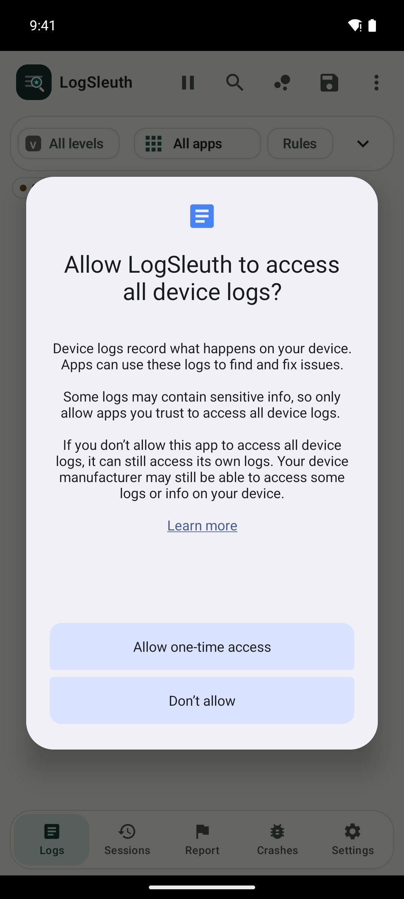
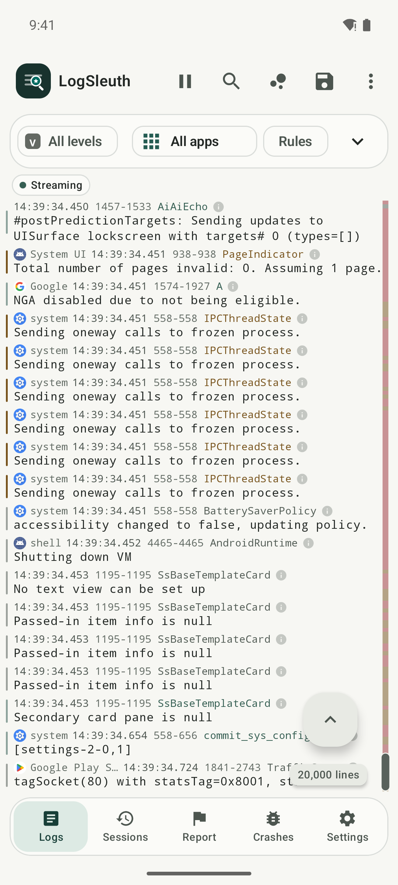
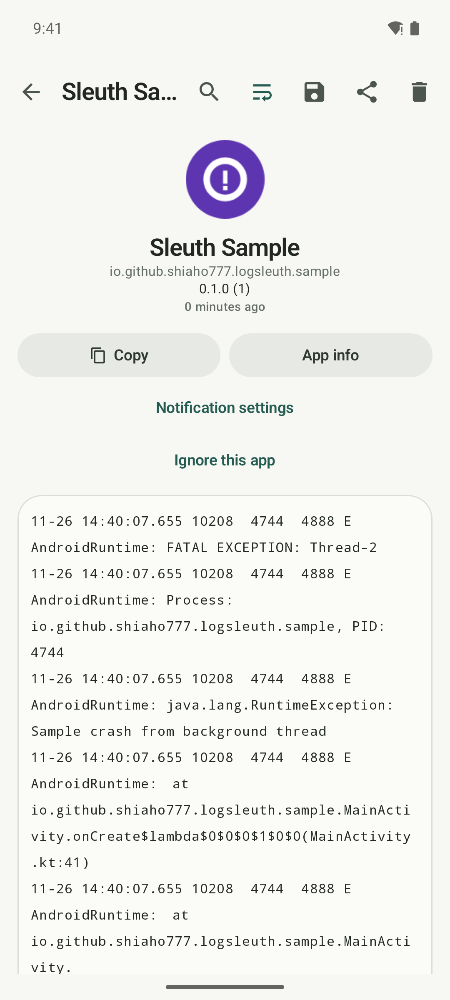

<div align="center">
  <h1>LogSleuth</h1>
  
  <p><strong>找到安卓故障前后的日志，把它保存成可以回放的会话。</strong></p>
  <p>可以看实时 Logcat、录下复现过程，也可以打开别人发来的报告。内嵌 SDK 能在你自己的应用里采集日志、崩溃和 ANR。</p>
  <p>
    <a href="https://github.com/shiaho777/LogSleuth/releases/latest">下载 APK</a> ·
    <a href="#快速上手">快速上手</a> ·
    <a href="#集成-sdk">集成 SDK</a> ·
    <a href="README.md">English</a>
  </p>
  <p>
    <a href="https://github.com/shiaho777/LogSleuth/actions/workflows/ci.yml"></a>
    <a href="LICENSE"></a>
  </p>
</div>

## 安装

LogSleuth 支持 **Android 8.0（API 26）及以上**。日常使用从 [GitHub Releases](https://github.com/shiaho777/LogSleuth/releases/latest) 下载名为 `LogSleuth-*.APK` 的安装包。

下方图库来自当前源码版。要体验首次启动的示例报告和图中的界面，可以[从源码构建](#构建与贡献)。稳定版 v0.4.2 APK 使用上一版界面。

## 截图

点击任意截图可查看原图。

<table align="center">
  <tr>
    <td width="25%" align="center" valign="top"><a href="docs/screenshots/viewer-fd19e78/01-welcome.png"></a><br><sub>首次启动</sub></td>
    <td width="25%" align="center" valign="top"><a href="docs/screenshots/viewer-fd19e78/02-log-access.png"></a><br><sub>权限设置</sub></td>
    <td width="25%" align="center" valign="top"><a href="docs/screenshots/viewer-fd19e78/03-android-approval.png"></a><br><sub>系统授权</sub></td>
    <td width="25%" align="center" valign="top"><a href="docs/screenshots/viewer-fd19e78/04-live-home.png"></a><br><sub>日志首页</sub></td>
  </tr>
  <tr>
    <td width="25%" align="center" valign="top"><a href="docs/screenshots/viewer-fd19e78/06-filter-controls.png"></a><br><sub>筛选条件</sub></td>
    <td width="25%" align="center" valign="top"><a href="docs/screenshots/viewer-fd19e78/13-session-replay.png"></a><br><sub>回放会话</sub></td>
    <td width="25%" align="center" valign="top"><a href="docs/screenshots/viewer-fd19e78/20-report-ready.png"></a><br><sub>采集结果</sub></td>
    <td width="25%" align="center" valign="top"><a href="docs/screenshots/viewer-fd19e78/23-crash-stack.png"></a><br><sub>异常堆栈</sub></td>
  </tr>
</table>

[截图采集信息](docs/screenshots/README.md)

## 快速上手

1. **打开第一份报告。** 源码版首屏可选「打开示例报告」，查看一次虚构的结账崩溃，也可选「导入日志文件」打开 ZIP、TXT 或 LOG。使用 v0.4.2 时，跳过设置向导再从「会话」导入。这两条体验路径都无需设备日志权限。
2. **沿时间线找故障。** 打开一个会话，在「日志」「崩溃」「书签」间切换。示例里的「点击支付」书签可以跳到附近的日志。点开一行，可在消息和原始日志之间切换。
3. **开始自己的采集。** 源码版首屏选择「采集设备日志」，也可以从「设置」打开设置向导。先筛选再录制，保存后点「预览日志」，确认内容再分享 TXT 或 ZIP。想跟踪一个特定应用时，可以从「上报」进入引导式录制。

### 选择日志来源

| 来源 | 适用场景 |
| --- | --- |
| **Shizuku** | 推荐给无 Root 的手机。启动 Shizuku 后授权 LogSleuth，可以按应用筛选，并在后台持续采集。 |
| **ADB 授权** | 有电脑时可用来读取本机日志。Android 13 及以上启动或重连日志流时，请让查看器保持在前台，以便确认系统授权。 |
| **Root** | 适用于已经 Root 的设备。在设置向导中主动开启「使用 Root」。 |
| **远程 ADB** | 源码版可通过传统 TCP ADB，在可信网络中读取第二台安卓设备的日志。 |

详细步骤见[日志权限指南](docs/zh/guide/log-access.md)和[远程设备指南](docs/zh/guide/remote-device.md)。

## 可以用它做什么

- **找到关键行。** 按级别、Tag、文本或正则筛选，组合包含和排除规则。可以在搜索结果间跳转，也可以用右侧的日志轨道寻找错误集中的位置。
- **保留故障前后。** 保存快照，或录制当前筛选后的日志流。复现时可从通知或可选的悬浮控件添加书签，稍后回到会话里查看那一刻的上下文。
- **排查崩溃和卡死。** 查看 Java 崩溃、原生崩溃和 ANR，阅读堆栈与已有的上下文日志。保存记录和通知提醒可以分别设置。
- **发出可回放的报告。** 预览会话后分享 TXT 或 ZIP，也可以把 SDK 导出的 ZIP 导回查看器。启用[自动化规则](docs/zh/guide/automation.md)后，可把匹配的日志行发送给自己选定的应用。

详细操作见[筛选与预设](docs/zh/guide/filters.md)和[录制与崩溃检测](docs/zh/guide/recording-and-crashes.md)。

## 本地 MCP

同一台手机上的 Termux Agent 可以通过 MCP 操作 LogSleuth。在「设置 → 本地 MCP」启用并配对后，可以让 Agent 录制日志、按行号查询和导出 ZIP。[安装与配对指南](docs/zh/guide/local-mcp.md)

## 集成 SDK

SDK 只采集宿主应用的日志、Java 崩溃和 ANR。它不声明安卓权限，不发起网络请求，还可以在落盘前按配置脱敏。用户无需安装 LogSleuth 查看器，也能从你的应用分享 ZIP。

当前稳定版 Release 提供查看器 APK。接入可先看仓库里的[示例应用](sample/)和 [SDK 源码模块](sdk/)。两者位于同一个 Gradle 构建时，在应用中加入模块依赖。

```kotlin
implementation(project(":sdk"))
```

在 `Application` 里初始化。如果新建了子类，请在 Manifest 的 `<application>` 上设置 `android:name=".MyApp"`。

```kotlin
import android.app.Application
import io.github.shiaho777.logsleuth.sdk.Sleuth

class MyApp : Application() {
    override fun onCreate() {
        super.onCreate()
        Sleuth.init(this)
    }
}
```

在 Activity 的帮助或反馈入口调用以下方法。

```kotlin
Sleuth.shareLogs(this)
```

如果要通过 Maven 产物验证接入，可以发布到当前检出的本地暂存仓库，再用该产物构建示例。[SDK 构建和发布说明](docs/developer/release.md#sdk-smoke-build)

## 构建与贡献

使用与 CI 一致的 **JDK 21**，并安装 **Android SDK Platform 36**。

```bash
git clone https://github.com/shiaho777/LogSleuth.git
cd LogSleuth
python3 scripts/check_string_parity.py
./gradlew assembleDebug test lint
```

查看器 APK 位于 `app/build/outputs/apk/debug/app-debug.apk`，SDK 示例 APK 位于 `sample/build/outputs/apk/debug/`。欢迎改进查看器、SDK、测试或翻译，参加前可看[贡献指南](CONTRIBUTING.md)和[开发者指南](docs/developer/index.md)。

## 帮助与隐私

- **看不到日志或应用名？** 先在「设置」里检查当前来源。[日志权限指南](docs/zh/guide/log-access.md)说明各来源的授权、重连行为，以及哪些来源能把日志关联到应用。
- **遇到问题？** 请提供 LogSleuth 版本、安卓版本、日志来源和复现步骤。附日志或截图前记得去掉私人信息。[提交 Bug](https://github.com/shiaho777/LogSleuth/issues/new?template=bug_report.yml)
- **日志会去哪里？** 采集文件保存在设备上。你使用导出或自动化功能时才会有对应的数据传出。查看器联网用于更新和你配置的远程日志源。
- **其他入口。** [使用指南](https://shiaho777.github.io/LogSleuth/zh/guide/) · [问题列表](https://github.com/shiaho777/LogSleuth/issues) · [QQ 群 1127256026](https://qm.qq.com/q/Gzj7CpirAs) · [Bilibili](https://space.bilibili.com/2127032909)

## 许可证

[Apache License 2.0](LICENSE)。本文使用项目自己的图标，以及查看器和 SDK 示例的界面截图。
